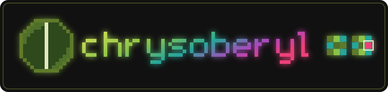

<div align="center">



### A structural diff for everything that is not text

_It reports what changed, not which pixels differ, and it gives the same verdict on every machine_

<p align="center">
  
  
  
  
</p>

<p align="center">
  <a href="https://github.com/stiven-gjekaj/chrysoberyl/actions/workflows/determinism.yml"></a>
  
</p>

<p align="center">
  <a href="#quick-start"><b>Quick Start</b></a> |
  <a href="#features"><b>Features</b></a> |
  <a href="#formats"><b>Formats</b></a> |
  <a href="#rules"><b>Rules</b></a> |
  <a href="docs/DESIGN.md"><b>Design</b></a>
</p>

</div>

---

## Overview

**Chrysoberyl** compares two images, animations, videos, PDF documents,
SVG files or 3D meshes. It does not print a count of changed pixels. It
names each change: moved, added, removed, recoloured or resized, with a
rectangle and a size.

```
$ chrys compare base.png candidate.png
Recoloured region at x=40, y=40, width=50, height=40, colour delta 115.65 (base [200, 40, 40, 255], candidate [40, 200, 200, 255])
```

The core value is one claim that a person can check: **a baseline is
portable**. The same pair gives the same verdict on Linux, macOS and
Windows, on x86-64 and on aarch64, and on any GPU. Each input is rasterized
on the CPU in a deterministic way. No pixel that enters a comparison comes
from a GPU. CI proves the claim on every push: six runners hash the raw
pixels and the verdicts, and the six reports must agree byte for byte.

There is no account and no hosted service. The baseline lives in your
repository.

The name comes from the stone. A cat's eye chrysoberyl shows one bright
line. Alexandrite, the same mineral, shows a different colour under a
different light. The same frame shows a different face under a different
decoder.

---

## Features

- **Named changes.** Each change has a kind, a bounding box, an offset for
  a move, and a colour difference for a recolour.
- **Refusal, not a guess.** The engine compares near-identical pairs only.
  A pair that it cannot register is refused, with the reason.
- **No antialiasing noise.** A difference that a person cannot see is not
  reported.
- **Scoped rules.** A TOML rule file tolerates a kind of change inside a
  named region or a mask. A rule cannot apply to a whole frame.
- **Baselines in git.** `chrys accept` writes a baseline and a manifest of
  digests. A compare against a baseline checks the manifest first.
- **A CI gate.** The exit code is 0 for no change, 1 for a change, 2 for a
  refusal, and 3 for an error. `--report` writes a TOML report.
- **A native window.** `chrys view` shows a pair side by side, as an
  overlay, or as a GPU difference map. Pan, zoom, step through the frames,
  and accept or reject.

---

## Quick Start

```bash
cargo build --release -p chrys-cli
```

```bash
./target/release/chrys compare tests/golden/rule-01/base.png tests/golden/rule-01/candidate.png
```

Turn on the optional formats and the window with Cargo features:

```bash
cargo build --release -p chrys-cli --features pdf,video,mesh,view
```

Accept a baseline, then compare a candidate against it:

```bash
chrys accept logo assets/logo.png
chrys compare --baseline logo build/logo.png --rule rules.toml --report report.toml
```

Open a pair in the window (feature `view`):

```bash
chrys view base.pdf candidate.pdf --accept-as cover
```

Keys: `1` side by side, `2` overlay, `3` difference map, arrows for the
frames, Space to flip the overlay, `a` to accept, `r` to reject, `q` to
close.

---

## Formats

Chrysoberyl finds the format from the content of a file, never from its
extension.

| Input | Reader | Feature |
|-------|--------|---------|
| PNG, JPEG, WebP, TIFF | `image` | default |
| GIF, APNG, animated WebP | frame by frame | default |
| A directory of numbered frames | frame by frame | default |
| SVG | `resvg`, one pinned font | default |
| PDF | `hayro`, one frame for each page | `pdf` |
| AV1 video in IVF | `re_rav1d`, paired by presentation time | `video` |
| OBJ and STL meshes | a fixed rig of eight views | `mesh` |

A video pair is paired by time, not by frame index. A copy at a different
frame rate is not a change.

A mesh renders through eight fixed cameras with a rasterizer written in
this repository. The output names the blind spot: the triangles that no
camera sees.

```
base.obj blind spot: 14 of 36 triangles are hidden in all eight views; ...
```

---

## Rules

A rule file is data. No rule is computed.

```toml
[[rule]]
kind = "recoloured"
region = "badge"
max_delta_e = 12.0
max_alpha_delta = 4
```

The region name comes from a hint file beside the image. See
[examples/rules/example.toml](examples/rules/example.toml) for each kind of
rule, with the reason for each limit.

---

## Project structure

```
crates/
  chrys-source            the Frame and Source types, with no format
  chrys-core              the engine: registration, residual, regions, verdict
  chrys-source-*          one adapter for each input family
  chrys-rule              the TOML rule engine
  chrys-baseline          the baseline store and its manifest
  chrys-gpu               the wgpu difference map, for display only
  chrys-view              the native window
  chrys-cli               the chrys binary
tests/golden/             the fixtures that the determinism gate hashes
scripts/                  the fixture generators and the determinism drills
docs/                     the design and the decisions
```

---

## Testing

```bash
cargo test --workspace --features chrys-cli/pdf,chrys-cli/view,chrys-cli/video,chrys-cli/mesh
```

The GPU equivalence tests need a GPU adapter:

```bash
cargo test -p chrys-gpu -- --ignored
```

The `determinism` workflow runs the digest report on six runners and
compares them byte for byte. A red `agree` job is a portability fault, not
a flaky test.

---

## Documentation

- [docs/DESIGN.md](docs/DESIGN.md): the invariants, the requirements, the
  gates, the open claims and the lessons.
- [docs/DECISIONS.md](docs/DECISIONS.md): each scope decision, with its
  date.
- [AGENTS.md](AGENTS.md): the rules for a change to this repository.

---

## Contributing

Contributions are welcome. See [CONTRIBUTING.md](CONTRIBUTING.md) to start,
follow the [Code of Conduct](CODE_OF_CONDUCT.md), and read
[SUPPORT.md](SUPPORT.md) if you need help. The [changelog](CHANGELOG.md)
records what changed. Report a security problem as
[SECURITY.md](SECURITY.md) says.

---

## License

Released under the MIT License. See [LICENSE](LICENSE) for the full text, and
[TERMS.md](TERMS.md) for the project terms.

<div align="center">
<sub>Built in Rust. One engine, one meaning of "changed".</sub>
</div>
